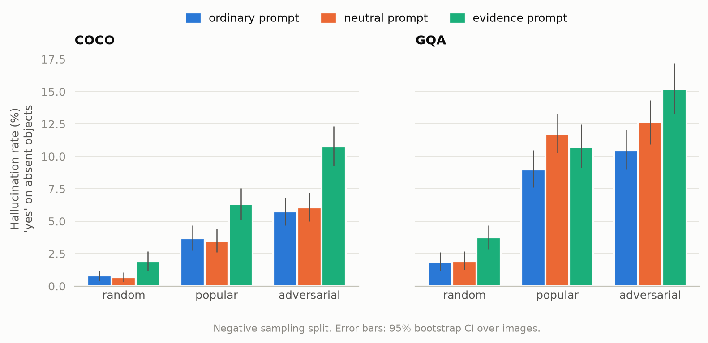
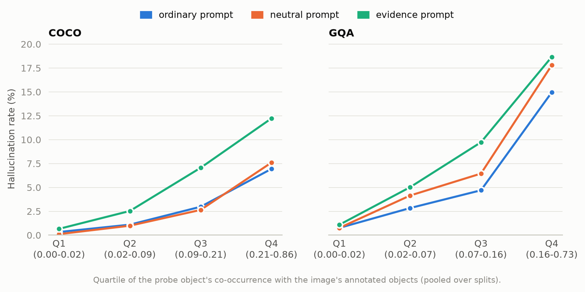
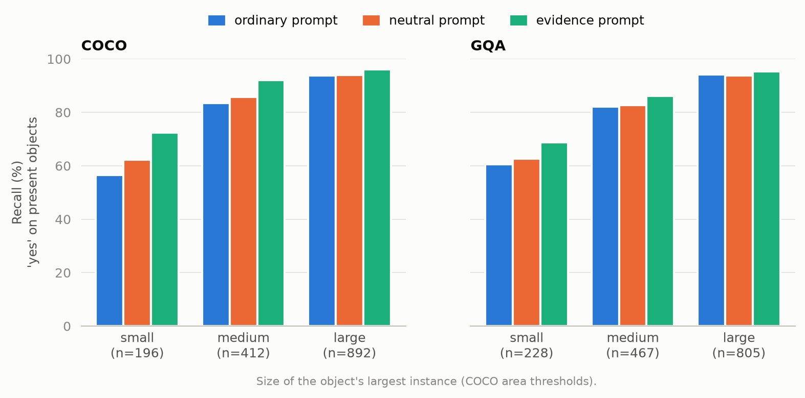
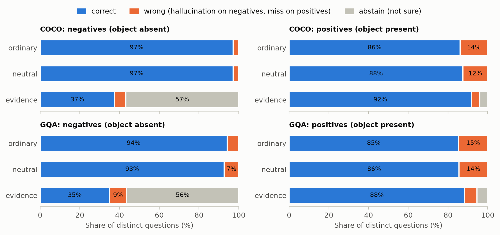
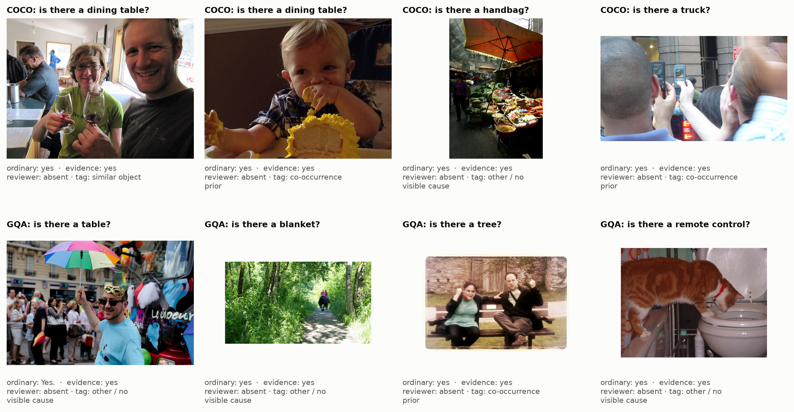
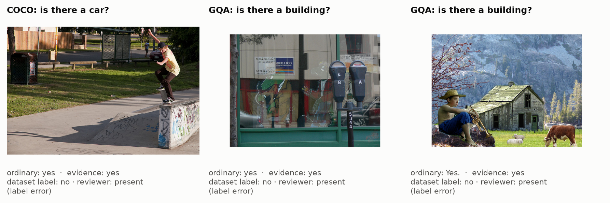

# Can Vision-Language Models Reject Objects That Are Not Present?

**CMPE 297 Term Project 5, Group 7.** Object hallucination in Qwen2.5-VL-3B-Instruct on POPE-style
questions over COCO and GQA.

> Every number in this report is copied from a table in `results/tables/`, which `src/score.py` and
> `src/analyze.py` generate from the logged model outputs. The notebook
> `notebooks/pope_hallucination_analysis.ipynb` regenerates and displays the same tables. Percentages
> are rounded to one decimal place.

## Summary

We asked Qwen2.5-VL-3B-Instruct 54,000 yes/no object-existence questions: 9,000 per dataset per
prompt, half about objects that are present and half about objects that are absent.

- **Error rates.** Under the standard POPE prompt, the model says *yes* to an absent object
  (hallucination rate):
  - 3.4% of the time on COCO and 7.1% on GQA;
  - but it says *no* to a present object 13.9% and 14.7% of the time.

  It is more conservative than hallucination-prone, and its misses are concentrated on small objects.
- **Negative sampling.** Choosing the absent object by frequency (*popular*) or by co-occurrence with
  the image's objects (*adversarial*) significantly raises hallucination over random sampling, on both
  datasets. Within every split, the hallucination rate rises with how strongly the absent object is
  suggested by what is in the image.
- **Permission to abstain.** Allowing the model to answer "not sure" does not remove hallucinations:
  95-96% of them stay *yes*. Instead it turns about 59% of the model's *correct* rejections into
  "not sure", and the hallucination rate rises.
- **Label errors.** A blind audit found that 11.3% of GQA "absent" labels are wrong (COCO: 4.0%), and
  79 of 100 reviewed GQA false positives were label errors. Much of the GQA hallucination rate is an
  artifact of incomplete scene graphs, not of the model.

## 1. Research question

When a vision-language model (VLM) is asked whether an object is in an image, does it recognise that
the object is absent, or does it confirm objects that are not there? We measure this
*object hallucination* and how it depends on four things:

1. **Negative sampling:** how the absent object is chosen (random, frequent, or co-occurring with
   what is in the image).
2. **Dataset:** COCO, with exhaustive category annotations, vs GQA, with open-vocabulary scene graphs.
3. **Question wording:** a standard question, a symmetric neutral question, and an evidence-focused
   question that explicitly allows "not sure".
4. **The object:** its size, its co-occurrence with the image content, and its category.

Because "absent in the annotations" is not the same as "absent in the image", we also audit the
labels by hand and report how much of the measured hallucination is label error.

## 2. Background and related work

**Object hallucination.** Object hallucination in vision-language models was first measured in image
captioning (CHAIR; Rohrbach et al., 2018): the share of mentioned objects that are not in the image.

**POPE.** POPE (Li et al., 2023) recasts it as a polling task: the model answers "Is there a/an
\<object\> in the image?" for ground-truth objects and for absent objects. Absent objects are sampled
three ways:
- **random:** any absent category;
- **popular:** the most frequent categories in the dataset;
- **adversarial:** the categories that co-occur most with the image's objects.

POPE showed that hallucination rises from random to adversarial sampling. It also showed that models
are biased towards answering *yes*. Its official COCO and GQA files use 500 images per dataset. The
GQA ground truth was obtained with the SEEM segmentation model (Zou et al., 2023).

**HallusionBench.** HallusionBench (Guan et al., 2024) probes related failures with harder visual
reasoning questions. We did not use it.

**Our additions to POPE.** We follow POPE's construction closely and add:
- a second ground-truth source for GQA (scene graphs with a curated vocabulary);
- prompt variants with matched token budgets, including abstention;
- a manual label audit;
- image-level bootstrap uncertainty estimates.

## 3. Model

**Model.** Qwen2.5-VL-3B-Instruct (Bai et al., 2025), Hugging Face revision
`66285546d2b821cf421d4f5eb2576359d3770cd3`, run in bf16 through the lmms-eval 0.7.4 `qwen2_5_vl`
wrapper (Zhang et al., 2024), with transformers 5.23.0 and torch 2.6.0+cu124 on one RTX 4080.

**Decoding.**
- Greedy decoding (`do_sample` false, one beam).
- `max_new_tokens` = 16 for every prompt, batch size 1.
- The wrapper's default system prompt ("You are a helpful assistant.").

**Image resolution.**
- Wrapper defaults: `min_pixels` 200,704, `max_pixels` 1,605,632.
- No COCO or GQA image exceeds the maximum, so none is downscaled.

**Run time.** The six full runs (2 datasets × 3 prompts, 9,000 questions each) took 2 h 19 min,
about 0.16 s per question.

## 4. Datasets and question construction

### 4.1 Shared construction (POPE procedure)

Both datasets use one sampler, `src/pope_sampling.py`, which reimplements the official POPE code.

1. **Images and positives.** An image is eligible if it has at least 3 distinct ground-truth objects.
   Its positives are its first 3 objects in annotation order.
2. **Negatives.** Each positive is paired with one negative per split, chosen from objects with
   **no** annotation in the image:
   - **random:** uniform, seeded per image;
   - **popular:** the most frequent objects (frequency counted over the selected images);
   - **adversarial:** the object that co-occurs most with that positive. If nothing co-occurs, a
     random absent object (POPE's fallback).
3. **Ties** are broken by first appearance, which reproduces POPE's ordering.
4. **Size.** Per dataset: 500 images, 3 positives and 3 negatives per image per split, so
   **9,000 questions** with 1,500 yes / 1,500 no in each split. Positives are identical across
   splits.
5. **Analysis fields.** Every row stores the object name and three fields for the effect studies:
   - `size_bin` (positives): small / medium / large by the largest instance's box area, using COCO's
     thresholds of 32² and 96² pixels;
   - `cooc_score` (negatives): the mean over the image's annotated objects of P(probe object | that
     object) in the selected images;
   - `freq_rank`: the object's frequency rank in the selected images.

### 4.2 COCO (baseline)

**Source.** COCO val2017 instance annotations (Lin et al., 2014): 80 exhaustively labelled
categories, with crowd annotations included as in POPE.

**Images.** We reused the 500 images of a teammate's earlier POPE file and rebuilt all questions with
our builder (`src/build_pope_coco.py`, seed 297).

**Consistency check.** We compared the rebuilt questions with that file, question by question
(`results/tables/teammate_set_comparison.md`):

| Split | "yes" questions | "no" questions |
|---|---|---|
| random | 1,500/1,500 (100.0%) | 13/1,500 (0.9%) |
| popular | 1,500/1,500 (100.0%) | 1,500/1,500 (100.0%) |
| adversarial | 1,500/1,500 (100.0%) | 1,498/1,500 (99.9%) |

- All positives and all popular negatives are identical.
- 1,498 of 1,500 adversarial negatives are identical; the other two differ only in tie order.
- Random negatives differ, as expected, because they come from a different random generator.
- The teammate's file was therefore almost certainly produced by the official POPE code. It also
  confirms that our builder reproduces POPE.
- The rebuilt set fixes two defects of the old file: 319/9,000 questions (3.5%) contained the typo
  "imange", and question ids were not unique across splits.

### 4.3 GQA (challenge set)

**Source.** The GQA validation scene graphs (Hudson & Manning, 2019), built on Visual Genome images
(Krishna et al., 2017). Objects carry about 1,700 free-form names, so "not in the scene graph" is much
weaker evidence of absence than in COCO.

**Vocabulary.** `src/gqa_vocab.py` restricts questions to a hand-pruned vocabulary of **100 concrete,
countable objects**. Parts, stuff, regions and clothing were removed. Each object has two name lists:
- **synonyms:** precise names that mean the object (e.g. *man*, *woman*, *player* → person;
  *bike* → bicycle). They count as presence for "yes" questions and block "no" questions.
- **blockers:** broader terms, visible parts and near-misses (e.g. *vehicle*, *tire* and *mug*
  block *car*, *car* and *cup*). They only block "no" questions.

A "no" question is never asked about an object whose synonyms or blockers appear in the image. With
this vocabulary, 6,261 of the 10,696 validation images have at least 3 vocabulary objects. We sampled
500 of them with seed 297 (`src/build_pope_gqa.py`).

**Difference from the official POPE-GQA files,** which used SEEM segmentation rather than scene
graphs: our ground truth inherits the scene graphs' incompleteness. The audit (§6.1) measures how
much this matters.

### 4.4 Frozen evaluation sets

**What is frozen.** `src/freeze_eval_set.py` validated both sets before any model was run:
- row counts and 50/50 balance per split;
- unique question ids;
- every image present on disk;
- no negative annotated in its image.

**The manifest.** It then wrote `data/eval_sets/MANIFEST.json`, with each file's SHA-256, its counts,
the builder seed, and the hashes of the source annotations. Every downstream script verifies these
hashes before running.

**Fixed before any output was seen:** the prompts, the parser and the audit sample. Audit outcomes
are stored separately and joined at scoring time, so the frozen files are never edited.

## 5. Evaluation methodology

### 5.1 Prompts

All three prompts are built from the stored object name with the correct article. They use the same
16-token output budget. The wording was fixed before the full runs.

| Key | Prompt (object = dog) |
|---|---|
| ordinary | Is there a dog in the image? Answer with yes or no. |
| neutral | Does the image contain a dog, or does it not? Answer with yes or no. |
| evidence | Look at the image carefully and answer based only on what is visibly present. Is there a dog in the image? Answer "yes" only if you can clearly see it. If it is not visible, answer "no". If you cannot tell, answer "not sure". |

- **ordinary** is the standard POPE question.
- **neutral** offers both outcomes symmetrically, to reduce a bias towards *yes*.
- **evidence** demands visual evidence and is the only prompt that permits abstention.

### 5.2 Parser

`src/parser.py` maps a response to *yes*, *no*, *abstain* or *invalid*:
1. It lowercases the response and strips quotes and punctuation.
2. An abstention phrase ("not sure", "unsure", "cannot tell", …) anywhere → *abstain*.
3. Otherwise, a first word of *yes* → *yes*; a first word of *no*, or "not visible" → *no*.
4. Anything else → *invalid*.

The parser was written once, covered by unit tests, and never tuned on results. On all 54,000
responses it produced **0 invalid parses**. The model answered only with variants of
*yes*/*Yes*/*Yes.*, *no*/*No*/*No.*, and (evidence prompt only) *not sure*. Scores are always
recomputed from the raw logged responses, not from the values computed during the run.

### 5.3 Metrics

The prediction is *yes*, *no* or *abstain* (invalid parses count as abstentions). Abstentions are
never correct.

| Metric | Definition |
|---|---|
| Accuracy | (TP + TN) / N |
| Precision | TP / (TP + FP) |
| Recall | TP / Npos (abstentions on positives count against recall) |
| F1 | harmonic mean of precision and recall |
| Specificity | TN / Nneg |
| **Hallucination rate** (false-positive rate, FPR) | FP / Nneg: *yes* on an absent object |
| **False-negative rate** (FNR) | *no* on a present object / Npos |
| Yes ratio | *yes* answers / N |
| Abstention rate | (abstain + invalid) / N, also split by positives and negatives |
| Class balance | Npos / N (50% in every split of the full set) |

On negatives, specificity + hallucination rate + negative abstention rate = 1. On positives, recall +
FNR + positive abstention rate = 1. The unit tests check both identities.

### 5.4 Uncertainty and significance

**Bootstrap.** We use one bootstrap over **images** (1,000 resamples, seed 297). Images are resampled
because the six questions about one image are not independent. The resamples are drawn once per
dataset and shared by every prompt and split.

**What it is used for.**
- **CIs:** 95% percentile intervals for accuracy, F1, hallucination rate and FNR.
- **Split comparisons:** the hallucination-rate differences random vs popular and random vs
  adversarial (ordinary prompt). These are paired: each resample scores both splits on the same
  images. A difference whose interval excludes 0 is called significant.

**Prompts** are compared descriptively, with no significance tests between prompts.

### 5.5 Label audit protocol

All judgments were made in a review tool (`src/audit_tool.py`). It shows the image at up to 2×
zoom and the object name, and records a verdict of *present*, *absent* or *uncertain*.

**Reviewer guidelines.**
- *Present*: any clearly recognisable instance, including small, partial, or depicted ones (poster,
  screen, mirror).
- *Absent*: confident after inspecting the whole image.
- *Uncertain*: too small, blurry or ambiguous to decide, or an unclear category boundary (bench vs
  chair).

**Stage A (predeclared, blind).** `src/sample_audit.py` drew the sample from the frozen sets before
any model output was examined (seed 297): per dataset, **150 positives and 150 negatives** (50 from
each split).
- The reviewer saw no label, split, model answer or annotation box. A box would reveal that the label
  is *yes*.
- One verdict covers every split a question occurs in.
- The sample spans 241 COCO and 229 GQA images.

**Stage B (model errors, not blind).** `src/sample_stage_b.py` (seed 297) drew from the
ordinary-prompt errors:
- **False positives:** 100 per dataset, sampled from 103 (COCO) and 213 (GQA) distinct ones.
- **False negatives:** 50 per dataset, sampled from 209 and 220.

Each item got a verdict and one error-taxonomy tag:
- **false positives:** label error · co-occurrence prior · similar object · depicted or reflected ·
  ambiguous category · other / no visible cause;
- **false negatives:** label error · small · occluded or truncated · unusual appearance · other.

The reviewer knew every Stage B item was a model error.

**Quality control before scoring.** A consistency check found two problems:
- Stage A positives judged *absent* at an implausibly high rate: COCO 16, GQA 23.
- 43 Stage B items whose tag contradicted their verdict (*label error* with a verdict that meant the
  label was right).

These items were re-reviewed before any scores were computed. Stage A positives judged absent fell
to COCO 2 and GQA 6. One additional GQA negative was changed to *present* during that pass. Every
Stage B verdict–tag pair is now consistent, which `score.py` enforces.

**Score views.** Audit results enter the scores as three views:
- **(a) full set, original labels:** primary, comparable to POPE;
- **(b) audited subset:** the 300 Stage A questions scored with the original labels and with the
  reviewer's verdicts (*uncertain* items excluded from both);
- **(c) label-quality summary.**

## 6. Results

### 6.1 Label quality

**View (c).** From `label_quality.md`:

| Stage A | COCO | GQA |
|---|---|---|
| Negatives (dataset says *no*) judged present | 6/150 (4.0%) | **17/150 (11.3%)** |
| Negatives judged uncertain | 4 (2.7%) | 5 (3.3%) |
| Positives (dataset says *yes*) judged absent | 2/150 (1.3%) | 6/150 (4.0%) |
| Positives judged uncertain | 8 (5.3%) | 9 (6.0%) |

| Stage B: reviewed ordinary-prompt errors tagged *label error* | COCO | GQA |
|---|---|---|
| False positives (object actually present) | 20/100 (20.0%) | **79/100 (79.0%)** |
| False negatives (object actually absent) | 15/50 (30.0%) | 21/50 (42.0%) |

**COCO** negatives are largely sound, at 4.0% present. That is under the 5% level at which we
planned to qualify the hallucination rate.

**GQA** is above that level: **part of the measured GQA hallucination rate is label error, not model
error.**
- 11.3% of its audited negatives are actually present.
- Four in five of the model's reviewed GQA "hallucinations" are correct answers about objects the
  scene graph omits, mostly background objects such as buildings and trees (§6.5).
- View (b) quantifies this (§6.3).

### 6.2 Main results (view a)

Table 1 (`metrics_headline_ci.md`) gives point estimates with 95% bootstrap CIs over images, in %:

| Dataset | Prompt | Split | Accuracy | F1 | Halluc (FPR) | FNR |
|---|---|---|---|---|---|---|
| COCO | ordinary | random | 92.6 [91.7, 93.5] | 92.1 [91.1, 93.1] | 0.8 [0.4, 1.2] | 13.9 [12.2, 15.5] |
| COCO | ordinary | popular | 91.2 [90.1, 92.2] | 90.7 [89.6, 91.8] | 3.7 [2.7, 4.7] | 13.9 [12.2, 15.5] |
| COCO | ordinary | adversarial | 90.2 [89.2, 91.2] | 89.7 [88.7, 90.9] | 5.7 [4.7, 6.8] | 13.9 [12.2, 15.5] |
| COCO | neutral | random | 93.4 [92.6, 94.3] | 93.0 [92.1, 94.0] | 0.7 [0.3, 1.1] | 12.5 [10.9, 14.1] |
| COCO | neutral | popular | 92.0 [91.1, 93.0] | 91.7 [90.7, 92.7] | 3.5 [2.6, 4.4] | 12.5 [10.9, 14.1] |
| COCO | neutral | adversarial | 90.7 [89.8, 91.8] | 90.4 [89.4, 91.5] | 6.1 [5.0, 7.2] | 12.5 [10.9, 14.1] |
| COCO | evidence | random | 64.2 [62.7, 65.8] | 94.8 [94.0, 95.6] | 1.9 [1.2, 2.7] | 4.1 [3.1, 5.0] |
| COCO | evidence | popular | 64.5 [63.0, 65.9] | 92.7 [91.8, 93.7] | 6.3 [5.1, 7.5] | 4.1 [3.1, 5.0] |
| COCO | evidence | adversarial | 66.3 [64.9, 67.9] | 90.7 [89.7, 91.6] | 10.8 [9.3, 12.3] | 4.1 [3.1, 5.0] |
| GQA | ordinary | random | 91.7 [90.8, 92.7] | 91.2 [90.1, 92.3] | 1.9 [1.2, 2.6] | 14.7 [13.0, 16.3] |
| GQA | ordinary | popular | 88.2 [87.1, 89.3] | 87.8 [86.7, 89.0] | 9.0 [7.6, 10.5] | 14.7 [13.0, 16.3] |
| GQA | ordinary | adversarial | 87.4 [86.3, 88.6] | 87.2 [86.0, 88.4] | 10.5 [9.0, 12.1] | 14.7 [13.0, 16.3] |
| GQA | neutral | random | 91.8 [90.9, 92.8] | 91.3 [90.2, 92.3] | 1.9 [1.3, 2.7] | 14.4 [12.7, 16.1] |
| GQA | neutral | popular | 86.9 [85.9, 88.0] | 86.8 [85.7, 87.9] | 11.7 [10.3, 13.3] | 14.4 [12.7, 16.1] |
| GQA | neutral | adversarial | 86.5 [85.4, 87.6] | 86.3 [85.2, 87.5] | 12.7 [10.9, 14.3] | 14.4 [12.7, 16.1] |
| GQA | evidence | random | 62.5 [61.0, 64.2] | 92.0 [91.0, 93.0] | 3.7 [2.9, 4.7] | 6.1 [5.0, 7.3] |
| GQA | evidence | popular | 60.0 [58.3, 61.6] | 88.8 [87.6, 89.9] | 10.7 [9.1, 12.5] | 6.1 [5.0, 7.3] |
| GQA | evidence | adversarial | 60.0 [58.5, 61.5] | 86.8 [85.6, 88.0] | 15.2 [13.3, 17.2] | 6.1 [5.0, 7.3] |

The FNR is identical across splits within a prompt because the positive questions are the same in
every split.

Table 2 (`metrics_full_original.md`) gives the remaining metrics, pooled over the three splits
(N = 9,000), in %:

| Dataset | Prompt | Acc | Prec | Rec | F1 | Spec | Halluc (FPR) | FNR | Yes ratio | Abstain | Abst. pos | Abst. neg |
|---|---|---|---|---|---|---|---|---|---|---|---|---|
| COCO | ordinary | 91.3 | 96.2 | 86.1 | 90.9 | 96.6 | 3.4 | 13.9 | 44.7 | 0.0 | 0.0 | 0.0 |
| COCO | neutral | 92.1 | 96.3 | 87.5 | 91.7 | 96.6 | 3.4 | 12.5 | 45.5 | 0.0 | 0.0 | 0.0 |
| COCO | evidence | 65.0 | 93.5 | 91.9 | 92.7 | 38.1 | 6.4 | 4.1 | 49.1 | 29.8 | 4.1 | 55.5 |
| GQA | ordinary | 89.1 | 92.3 | 85.3 | 88.7 | 92.9 | 7.1 | 14.7 | 46.2 | 0.0 | 0.0 | 0.0 |
| GQA | neutral | 88.4 | 90.7 | 85.6 | 88.1 | 91.2 | 8.8 | 14.4 | 47.2 | 0.0 | 0.0 | 0.0 |
| GQA | evidence | 60.8 | 89.9 | 88.4 | 89.2 | 33.3 | 9.9 | 6.1 | 49.1 | 31.2 | 5.5 | 56.8 |

Class balance is 50% in every row. Abstentions occur only under the evidence prompt.

**Validation.**
- Re-scoring the logged responses with our parser reproduces lmms-eval's in-run aggregates for all
  six tasks.
- Ordinary-prompt COCO random-split accuracy (92.6%) is in the range expected for this model class
  on POPE.
- We did not run the official POPE (COCO val2014) files as an extra check.

### 6.3 Audited subset with corrected labels (view b)

These are the 300 Stage A questions per dataset, each counted once, with *uncertain* items excluded.
From `metrics_audited.md`, in %:

| Dataset | Prompt | Labels | N | Acc | Prec | Rec | Spec | Halluc (FPR) | FNR |
|---|---|---|---|---|---|---|---|---|---|
| COCO | ordinary | original | 288 | 92.4 | 99.2 | 85.2 | 99.3 | 0.7 | 14.8 |
| COCO | ordinary | corrected | 288 | 91.0 | 99.2 | 82.9 | 99.3 | 0.7 | 17.1 |
| COCO | evidence | original | 288 | 65.6 | 95.6 | 90.8 | 41.1 | 4.1 | 2.1 |
| COCO | evidence | corrected | 288 | 64.6 | 96.3 | 89.0 | 39.4 | 3.5 | 4.8 |
| GQA | ordinary | original | 286 | 88.5 | 90.3 | 85.8 | 91.0 | 9.0 | 14.2 |
| GQA | ordinary | corrected | 286 | 90.2 | 96.3 | 84.9 | 96.3 | **3.7** | 15.1 |
| GQA | neutral | original | 286 | 87.1 | 87.7 | 85.8 | 88.3 | 11.7 | 14.2 |
| GQA | neutral | corrected | 286 | 90.9 | 95.7 | 86.8 | 95.5 | **4.5** | 13.2 |
| GQA | evidence | original | 286 | 58.7 | 89.2 | 87.9 | 30.3 | 10.3 | 7.1 |
| GQA | evidence | corrected | 286 | 62.2 | 95.0 | 86.8 | 34.3 | 5.2 | 5.3 |

**GQA.** On the same questions, correcting the labels cuts the ordinary-prompt hallucination rate
from 9.0% to 3.7%, and the neutral prompt's from 11.7% to 4.5%.

**COCO.** The rate does not change (0.7% in both). The COCO corrections mostly move present-but-
unannotated objects into the positives that the model misses, so COCO's FNR rises instead.

The audited subset is small (134-146 negatives), so these are indicative rather than precise. They
agree with Stage B: most of GQA's excess hallucination over COCO is label error.

### 6.4 Do popular and adversarial negatives raise hallucination?

**Yes, on both datasets.** All four differences are significant. From `split_comparison.md` (ordinary
prompt, paired image bootstrap):

| Dataset | Comparison | FPR first (%) | FPR second (%) | Difference (pp) | 95% CI (pp) | Significant |
|---|---|---|---|---|---|---|
| COCO | random vs popular | 0.8 | 3.7 | +2.9 | [+1.9, +3.9] | yes |
| COCO | random vs adversarial | 0.8 | 5.7 | +4.9 | [+3.8, +6.1] | yes |
| GQA | random vs popular | 1.9 | 9.0 | +7.1 | [+5.6, +8.8] | yes |
| GQA | random vs adversarial | 1.9 | 10.5 | +8.6 | [+6.9, +10.3] | yes |

The ordering random < popular < adversarial holds under every prompt (Table 1, Figure 1).

*Figure 1. Hallucination rate by negative-sampling split and prompt. Error bars: 95% bootstrap CI over
images.*

### 6.5 Effect studies

These use distinct (image, object) questions: a positive is counted once, not once per split
(`src/analyze.py`).

**Co-occurrence.** The hallucination rate rises steadily with the absent object's co-occurrence with
the image's annotated objects (Figure 2). From `effect_cooc.md`, ordinary prompt, pooled over splits,
in %:

| Dataset | Q1 (lowest) | Q2 | Q3 | Q4 (highest) |
|---|---|---|---|---|
| COCO | 0.3 (n=907) | 1.1 (n=908) | 3.0 (n=907) | 6.9 (n=908) |
| GQA | 0.8 (n=916) | 2.8 (n=915) | 4.7 (n=915) | 15.0 (n=916) |

- **Within one split.** The rise also appears inside the random split: COCO 0.3 / 1.1 / 1.6 / 4.3,
  GQA 0.7 / 2.7 / 2.7 / 16.7, though the top quartiles there are small (n = 47 and 36). Popular and
  adversarial sampling raise hallucination largely *because* they pick objects with higher
  co-occurrence.
- **Object frequency.** It matters less consistently. The pooled ordinary-prompt rate by frequency
  rank band 1-5 / 6-20 / 21-50 / 51+ is COCO 3.5 / 4.2 / 1.6 / 0.8 and GQA 9.9 / 5.3 / 4.8 / 0.5. Rare
  objects are almost never hallucinated.

*Figure 2. Hallucination rate by quartile of the probe object's co-occurrence score, pooled over
splits.*

**Object size.** Misses concentrate on small objects (Figure 3). From `effect_size.md`, recall in %:

| Dataset | Prompt | small | medium | large |
|---|---|---|---|---|
| COCO | ordinary | 56.6 (n=196) | 83.5 (n=412) | 93.7 (n=892) |
| COCO | evidence | 72.4 | 92.0 | 96.1 |
| GQA | ordinary | 60.5 (n=228) | 82.2 (n=467) | 94.2 (n=805) |
| GQA | evidence | 68.9 | 86.1 | 95.3 |

- Under the ordinary prompt, 43.4% (COCO) and 39.5% (GQA) of small present objects are answered *no*.
- The evidence prompt recovers many of them. It also abstains on 17.9% and 21.9% of small objects,
  so its gain is partly a shift from *no* to *not sure*.

*Figure 3. Recall on present objects by size of the largest instance (COCO area thresholds).*

**Question wording.**
- **Ordinary vs neutral.** The two prompts behave almost identically: only 1.0-3.2% of questions
  change answer between them (`prompt_flips.md`).
- **Neutral on GQA.** The neutral prompt's GQA hallucination rate is higher than the ordinary
  prompt's on the popular and adversarial splits (11.7% and 12.7% vs 9.0% and 10.5%, Table 1). The
  symmetric wording did not reduce acquiescence. We report this descriptively; prompts were not
  tested for significance.
- **Evidence prompt.** It changes the answer to 59.9% (COCO) and 59.6% (GQA) of negatives. The table
  below shows what happens to the ordinary prompt's answers under it (`prompt_flips.md`, distinct
  questions):

| Dataset | Ordinary answer | N | Evidence: yes | Evidence: no | Evidence: not sure |
|---|---|---|---|---|---|
| COCO | negatives: *yes* (hallucination) | 103 | 99 (96.1%) | 3 (2.9%) | 1 (1.0%) |
| COCO | negatives: *no* (correct) | 3527 | 105 (3.0%) | 1358 (38.5%) | 2064 (58.5%) |
| COCO | positives: *no* (miss) | 209 | 89 (42.6%) | 59 (28.2%) | 61 (29.2%) |
| GQA | negatives: *yes* (hallucination) | 213 | 202 (94.8%) | 3 (1.4%) | 8 (3.8%) |
| GQA | negatives: *no* (correct) | 3449 | 114 (3.3%) | 1276 (37.0%) | 2059 (59.7%) |
| GQA | positives: *no* (miss) | 220 | 52 (23.6%) | 89 (40.5%) | 79 (35.9%) |

**Permission to abstain removes correct answers, not hallucinations.**
- Almost every ordinary-prompt hallucination stays *yes*.
- Most of the model's correct rejections become "not sure". A further 3% become new *yes* answers,
  so the evidence prompt's hallucination rate is higher (COCO 6.4% vs 3.4%, GQA 9.9% vs 7.1%).
- Abstention falls almost entirely on absent objects: 55.5% / 56.8% of negatives vs 4.1% / 5.5% of
  positives (Table 2). The model uses "not sure" as a polite *no*, not as a signal of genuine
  uncertainty about objects it might be imagining.
- Its F1 looks better than the ordinary prompt's (92.7% vs 90.9% on COCO) only because F1 ignores
  rejected negatives. Specificity (38.1%) and accuracy (65.0%) show the real cost.

*Figure 4. Share of correct, wrong and abstained answers by prompt, for absent and present objects.*

**Category-specific errors.** From `top_objects.md`, ordinary prompt, distinct questions (errors /
questions about that object):

| Dataset | Most hallucinated | Most missed |
|---|---|---|
| COCO | dining table 32/402, chair 16/377, handbag 8/91, backpack 7/60, truck 5/81 | chair 21/94, person 19/295, car 16/84, cup 14/32, backpack 9/23 |
| GQA | building 60/336, tree 39/320, table 25/357, plate 13/81, bag 10/193 | person 22/241, car 15/50, tree 12/124, flower 9/28, building 9/106 |

- **COCO.** Hallucinations concentrate on furniture and accessories that typically accompany the
  scene (tables at meals, bags with people).
- **GQA.** The top two are *building* and *tree*. Stage A judged these present most often among GQA
  negatives: background objects the scene graphs leave out.

**Dataset contrast.** Under the same prompt and split, GQA is less accurate than COCO by 0.9 (random)
to 3.0 pp (popular) with the ordinary prompt (`dataset_contrast.md`). Its hallucination rate is
higher in every split. Given §6.1 and §6.3, much of this gap reflects GQA's label noise rather than
harder images.

### 6.6 Error taxonomy and examples

Stage B tags for the reviewed ordinary-prompt errors (`label_quality.md`; counts out of 100 false
positives and 50 false negatives per dataset):

| False-positive tag | COCO | GQA |
|---|---|---|
| similar object | 52 | 9 |
| co-occurrence prior | 23 | 5 |
| label error | 20 | 79 |
| other / no visible cause | 5 | 6 |
| ambiguous category | 0 | 1 |

| False-negative tag | COCO | GQA |
|---|---|---|
| small | 15 | 10 |
| occluded or truncated | 14 | 14 |
| unusual appearance | 6 | 5 |
| label error | 15 | 21 |

**COCO false positives.** Genuine COCO hallucinations are mostly confusions with a similar object
(e.g. a counter or desk read as a dining table) or co-occurrence priors (a table assumed at a meal).

**GQA false positives.** Most GQA "hallucinations" are label errors.

**False negatives.** Model misses are mostly small or occluded objects. 30-42% of reviewed false
negatives are label errors, i.e. the "present" object is not actually visible.

*Figure 5. Unsupported "yes" answers: ordinary-prompt false positives the reviewer confirmed absent,
with the evidence prompt's answer and the taxonomy tag.*

*Figure 6. Ordinary-prompt "false positives" where the object is actually present: the dataset label
is wrong.*

## 7. Discussion

**Does the model reject absent objects?** Mostly, yes. With the standard POPE prompt it rejects
96.6% of absent COCO objects and 92.9% of absent GQA objects. Its bias runs the other way from the
classic POPE finding:
- its yes ratio is below 50% (44.7% COCO, 46.2% GQA);
- its false-negative rate (13.9% / 14.7%) is several times its hallucination rate.

Missing small objects is a bigger error source for this model than inventing objects.

**Do popular and adversarial negatives raise hallucination?** Yes, significantly on both datasets,
by +2.9 to +8.6 pp.
- The co-occurrence analysis explains why: hallucination rises with how strongly the image's content
  suggests the absent object, even inside the random split.
- So the model's errors are driven by contextual priors. A dining table is "expected" at a meal, a
  building is "expected" in a street scene.

**Does the prompt format change it?**
- **Neutral wording:** no meaningful effect on COCO; slightly more hallucination on GQA's harder
  splits.
- **Evidence-focused prompt with explicit abstention:** this was the intervention most likely to
  help, and it fails in a specific way.
  - It almost never retracts a hallucination.
  - It converts most correct rejections into "not sure", and adds a few new hallucinations.
  - It does recover missed positives, raising recall substantially.
  - In effect it lowers the model's threshold for *yes* and uses "not sure" for objects the model
    would otherwise have rejected.
- For this model, permission to abstain is therefore not a mitigation for object hallucination.
  A calibrated abstention threshold or a detector cross-check would be needed instead (not studied).

**How much of the measured hallucination is real?**
- **COCO:** most of it. 4.0% of audited negatives were present, and 20 of 100 reviewed false
  positives were label errors.
- **GQA:** not much. 11.3% of audited negatives were present, 79 of 100 reviewed false positives
  were label errors, and on the audited subset the hallucination rate falls from 9.0% to 3.7% after
  correction.

POPE-style benchmarks built from incomplete annotations, here GQA scene graphs, overstate
hallucination. Absolute GQA hallucination rates should be read with that caveat. The *relative*
findings hold on both datasets: the split ordering, the co-occurrence trend, and the effect of the
abstention prompt.

## 8. Limitations

- **Audit size and design.**
  - The audit is small: 300 Stage A and 150 Stage B items per dataset, so view (b) and the taxonomy
    shares are imprecise.
  - Each item had a single reviewer, so there is no inter-annotator agreement measure.
  - Stage B is not blind.
- **Example selection.** Representative examples were hand-picked from the reviewed items, replacing
  borderline images.
- **GQA ground truth.**
  - It comes from scene graphs and a hand-built 100-object vocabulary with synonym and blocker lists.
  - It is incomplete for background objects, and some names map imperfectly. For example, GQA's
    "bike" is sometimes a motorcycle.
  - It differs from the official POPE-GQA files, which used SEEM segmentation.
- **Scope.**
  - One model (3B parameters), one 500-image sample per dataset, one sampling seed, and greedy
    decoding only.
- **Parser coverage.** The fixed parser saw only the short answers this model produced (0 invalid
  parses). Other models' longer answers might need new rules.

## 9. Conclusions

1. Qwen2.5-VL-3B-Instruct rarely hallucinates objects on COCO (3.4% overall, ordinary prompt). It
   misses present objects, especially small ones, far more often.
2. Hallucination rises significantly from random to popular to adversarial negatives on both
   datasets. Co-occurrence between the absent object and the image content drives it.
3. Explicit permission to answer "not sure" does not reduce hallucination. It replaces correct
   rejections with abstentions and slightly increases false *yes* answers.
4. Label quality matters as much as the model for GQA: most reviewed GQA false positives are label
   errors. Audited, label-corrected results should accompany POPE-style numbers on datasets without
   exhaustive annotations.

## 10. Team contributions

> **To be completed by the team before submission:** one row per member.

| Member | Contributions |
|---|---|
| *(name)* | Original 500-image COCO selection and POPE question file; lmms-eval custom task on which `tasks/pope_custom/` is based |
| *(name)* | |
| *(name)* | |

## 11. References

- Bai, S., et al. (2025). *Qwen2.5-VL Technical Report.* arXiv:2502.13923. Model card:
  https://huggingface.co/Qwen/Qwen2.5-VL-3B-Instruct
- Guan, T., et al. (2024). *HallusionBench: An Advanced Diagnostic Suite for Entangled Language
  Hallucination and Visual Illusion in Large Vision-Language Models.* CVPR 2024.
- Hudson, D. A., & Manning, C. D. (2019). *GQA: A New Dataset for Real-World Visual Reasoning and
  Compositional Question Answering.* CVPR 2019.
- Krishna, R., et al. (2017). *Visual Genome: Connecting Language and Vision Using Crowdsourced Dense
  Image Annotations.* IJCV 123, 32-73.
- Li, Y., Du, Y., Zhou, K., Wang, J., Zhao, W. X., & Wen, J.-R. (2023). *Evaluating Object
  Hallucination in Large Vision-Language Models.* EMNLP 2023. arXiv:2305.10355. Code:
  https://github.com/AoiDragon/POPE
- Lin, T.-Y., et al. (2014). *Microsoft COCO: Common Objects in Context.* ECCV 2014.
- Rohrbach, A., Hendricks, L. A., Burns, K., Darrell, T., & Saenko, K. (2018). *Object Hallucination in
  Image Captioning.* EMNLP 2018.
- Zhang, K., et al. (2024). *LMMs-Eval: Reality Check on the Evaluation of Large Multimodal Models.*
  arXiv:2407.12772. Code: https://github.com/EvolvingLMMs-Lab/lmms-eval
- Zou, X., et al. (2023). *Segment Everything Everywhere All at Once* (SEEM). NeurIPS 2023.
